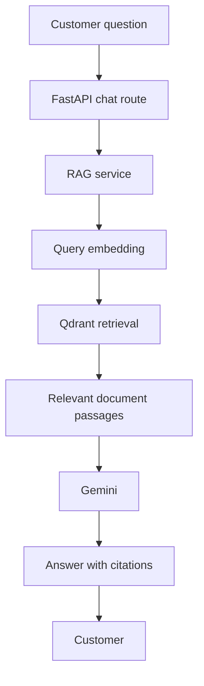

# Architecture

The application has three straightforward layers:

1. **Routes** handle HTTP input and responses.
2. **RagService** connects the document and question workflows.
3. **Small modules** perform extraction, chunking, embedding, storage, and generation.

## Follow the code

`main.py` creates the services and registers the routers. It loads Qwen in a
background thread so the frontend can show a loading state. Configuration comes
from `.env` through `config.py`.

`api/documents.py` reads an upload asynchronously, checks its size, and runs
blocking ingestion in a thread pool. The service saves the original, extracts
pages, creates overlapping token windows, embeds them, and stores Qdrant points.
SQLite records the document's name, status, and metadata.

`api/chat.py` calls retrieval and generation. Qwen embeds the question; Qdrant
returns passages; Gemini receives those passages and returns an answer with
source IDs. The service returns the cited passages to the browser.

`api/documents.py` also serves originals and passage details. The source reader
uses page character offsets to highlight evidence. A small text-match check
prevents showing an unrelated highlight.

## Request-response flow

Document ingestion is separate: the administrator uploads a PDF or TXT file,
the service extracts pages, splits them into overlapping chunks, generates
embeddings, and stores the vectors with text and metadata in Qdrant. SQLite
tracks the document record and the original file stays in local storage.

## Why these choices

- Qdrant handles vector search; SQLite handles document records.
- Metadata lives beside each vector so retrieval returns evidence and provenance.
- One local lock coordinates ingestion, retrieval, and deletion.
- Blocking model/database calls remain in synchronous FastAPI routes, which run
  in a thread pool. Async is used for upload reads and application lifecycle.
- Gemini uses one model and one attempt. Citation validation rejects source IDs
  that are not in the retrieved passages. Source cards also work without inline labels.
- Frontend helpers share API calls, source cards, and the NovaFiber shell.

The six tests check basic request behavior with isolated storage and model
substitutes. They avoid live network calls and failure-injection machinery.

This is a single-process local MVP. It has no authenticated roles, queues,
automatic model fallback, backoff logic, or startup reconciliation. Explain
these boundaries before describing future features in an interview.

## Engineering Design Decisions and Trade-offs

### Local Qwen embeddings

I chose `Qwen/Qwen3-Embedding-0.6B` to avoid external embedding API costs and
rate limits, retain control over the model configuration, and generate embeddings
offline once the weights are downloaded and cached. The trade-off is local CPU
and RAM usage, with potentially slower inference on a laptop. The application
uses normalized 1,024-dimensional vectors and the model's query prompt for questions.
Gemini answer generation still requires an internet connection.

### Highlighted source citations

I implemented highlighted citations so users can identify the passages supporting
an answer and verify them against the original documents. The tokenizer supplies
character offsets for each token; I use the chunk's first and last offsets to
save its character range within extracted page text. The source reader highlights
that range and links to the original PDF page. This makes evidence traceable,
but it does not independently prove every generated claim is supported.

### SQLite and Qdrant

I use Qdrant to store and retrieve embeddings alongside chunk text and metadata.
SQLite stores structured document records: filenames, upload statuses, file hashes,
storage paths, and chunk counts. Separating these responsibilities keeps vector
search separate from document management. The two stores do not share a transaction;
the local service uses one lock and basic failure cleanup to keep the workflow simple.

### Modular RAG pipeline

I separated extraction, chunking, embeddings, vector storage, and generation into
small modules. Retrieval and workflow coordination live in `rag.py`, rather than
adding another forwarding layer. This makes individual stages easier to debug,
test, maintain, and change without rewriting the pipeline.

### Centralized configuration

I use Pydantic Settings in `config.py` to manage chunk size, overlap, retrieval
parameters, embedding configuration, database paths, and Gemini settings.
Defaults live in one place, while `.env` or environment variables can override
them. This keeps credentials out of source code and avoids scattered settings.
Changing the model or chunk settings does not automatically update stored vectors;
existing documents need re-ingestion when those settings change.

### Why I chose Gemini

I previously used the Gemini API in IntelliResume, my AI-powered resume analyzer.
Reusing that experience let me focus on learning and implementing the RAG pipeline.
This application makes one request to one configured model. Hosted generation
introduces network dependence, provider quotas, and occasional availability errors.

### Why a fictional broadband company

I built NovaFiber as a domain-specific chatbot to simulate realistic broadband
customer support, with troubleshooting, billing, equipment, and account policies.
The company and policies are fictional. The implemented app answers policy questions
and provides source links; it cannot access customer accounts or live outages.

My longer-term goal is to add agentic AI features for customer-authorized support
ticket creation and ticket tracking. These are planned features, along with login
and backend permissions; none of them is implemented yet.
